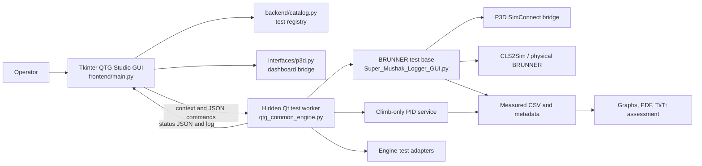

# QTG Studio application architecture

This document describes the current source layout and runtime paths in this workspace. It separates the visible front end from the test worker, simulator/hardware integrations, and reporting. The test folders are not thirty separate applications: the catalog shares one execution path, with specific adapters for climb and the two engine tests.

## At a glance

The dashboard and test workspace are Tkinter. The BRUNNER base is a PySide6/Qt application used *inside a hidden worker process*; its separate GUI is not shown by QTG Studio. The worker owns the test P3D and BRUNNER connections. The Tkinter process sends commands and reads status; it also has a separate P3D bridge for dashboard telemetry and settings actions.

## Workspace map

| Path | Responsibility |
| --- | --- |
| `QTG_STUDIO/main.py` | Source and packaged bootstrap entry point, including `--brunner-test`. |
| `QTG_STUDIO/frontend/main.py` | Visible GUI, settings, launch/status controls, dashboard logs, and some report dispatch. |
| `QTG_STUDIO/frontend/pid_monitor.py` | Existing PID monitor UI code. |
| `QTG_STUDIO/backend/` | Shared test catalog, typed JSON contracts, reference/condition verification, control-method rules, duration limits, result naming and status snapshots. `runner.py` and `initializer.py` retain compatibility with the current worker implementation. |
| `QTG_STUDIO/interfaces/p3d.py` | Native bridge wrapper used by dashboard telemetry and settings commands; no Tkinter dependency. |
| `QTG_STUDIO/interfaces/brunner.py` | Adapter to the existing BRUNNER base loader; no duplicate hardware connection. |
| `QTG_STUDIO/reports/` | Climb/engine report routing plus the existing graph, engine-report, and timing-rule implementations. |
| `QTG_STUDIO/qtg_backend/` | Compatibility entry points for the hidden worker and former P3D bridge import path. |
| `QTG_STUDIO/qtg_common_engine.py` | Existing shared launch, command/status IPC, test dispatch and hidden worker lifecycle. It imports shared validation, registry, artifact naming and snapshot logic from `backend/`. Its hardware state machine remains here during the compatibility migration. |
| `QTG_STUDIO/test_suites/normal_climb/procedure.py` | Normal Climb PID Automatic preparation, airspeed hold, recording gate, safe stop and climb-specific report handling. |
| `QTG_STUDIO/qtg_climb_pid.py`, `qtg_pid_monitor.py`, `qtg_position_setter.py` | Compatibility imports/entry points for the moved modules. |
| `QTG_STUDIO/reports/plot_graphs.py` | Application graph/report implementation; the root `plot_graphs.py` preserves its previous import path. |
| `QTG_STUDIO/reports/SMK_Engine_TiTt_V2_1_3_Addon.py` | Engine acceleration/deceleration Ti/Tt extraction, comparison and PDF/PNG charts. |
| `QTG_STUDIO/backend/engine_*.py` | Engine-specific preparation and diagnostic helpers. |
| `QTG_STUDIO/interfaces/climb_brunner*.py`, `p3d_simconnect_v15.py` | Legacy BRUNNER transport and SimConnect adapters. |
| `QTG_STUDIO/frontend/SMK_Engine_From_Climb.py`, `Super_Mushak_Logger_V15_FULL_CAUSAL_STATE.py` | Older standalone Qt GUIs. Root modules preserve their import/launch paths. |
| `QTG_STUDIO/interfaces/brunner_base/Super_Mushak_Logger_GUI.py` | Existing Manual and Recorded Replay initialization, control, telemetry capture and recording base. QTG reuses its methods. |
| `interfaces/brunner_base/src/brunner_interface.py` | BRUNNER/CLS2Sim socket communication and physical control read/write. |
| `interfaces/brunner_base/src/p3d_simconnect_v15.py` | P3D telemetry, initialization, pause, throttle and supported state writes through the native bridge. |
| `interfaces/brunner_base/src/replay_support.py` | Reference interpolation, throttle replay, replay tracking and state/weather helpers. |
| `interfaces/brunner_base/src/plot_graphs.py` | BRUNNER-base graph/report pathway; distinct from the application plotter. |
| `interfaces/brunner_base/native/src/`, `interfaces/brunner_base/native/bin/` | Native P3D bridge source and runtime DLL. |
| `test_suites/normal_climb/pid_source/SMK_IAS_PID_BRUNNER_ONLY_V4_1.py` | Original standalone PID implementation used as the algorithm source for climb integration. |
| `test_suites/<test>/` | Per-test documentation and, for engine tests, runtime `procedure.py` policy. `definition.json` is a catalog/documentation export, not the authoritative runtime settings store. |
| `test_suites/_shared/engine_initialization.py` | Engine-test adapter around the BRUNNER base for supported initialization and reference checks. |
| `docs/` | Workspace and architecture documentation. |

The source-local `recorded_tests/`, BRUNNER `Output/`, `report_previews/`, `release_backups/`, build directories and archived material serve different historical, preview, diagnostic or release purposes. They are not interchangeable with current runtime results.

## Front end

`frontend/main.py` defines the `App(tk.Tk)` window. Its main areas are:

1. **Dashboard:** yearly results, saved report list, log table and navigation to the test guide and initial tests.
2. **Test browser/workspace:** SEP test list, objective, reference page, initial conditions and tolerance text, Manual/Automatic controls, live connection/flight/recording status, progress, Manual-reference selector and stop controls.
3. **Test settings panel:** password-gated editable initial conditions, Automatic control method where supported, duration, report graph selections and optional CSV inputs. Settings are passed into a run context when a test launches.
4. **Report access:** opens the latest PDF and saved yearly-result entries from runtime metadata.

The catalog is defined by `TESTS`/`TestSpec` in `backend/catalog.py` and supplemented by `test_catalog.csv` and reference assets. The current GUI shows SEP tests; the MEP catalog entry is disabled. A listed catalog test is not necessarily a fully specialized automated procedure. The three most developed execution pathways are Normal Climb, Engine Acceleration and Engine Deceleration.

### Backend boundary and migration status

The split is represented by `frontend/`, `backend/`, `interfaces/`, `reports/`, and `test_suites/` under `QTG_STUDIO/`. Root `main.py` remains the launch entry; `qtg_common_engine.py` remains the worker entry and compatibility API. Both use the same backend catalog and contracts. The worker imports reference/initial-condition validation, output naming, duration rules, engine policy lookup, and status snapshots from `backend/`. The dashboard imports its P3D bridge from `interfaces/`. `qtg_backend/` preserves the prior import path and worker bootstrap.

The hardware state machine, Automatic initialization, replay, recorder lifecycle, and report implementation still execute through the established `qtg_common_engine.py` and BRUNNER base. The climb PID algorithm now resides in `test_suites/normal_climb/procedure.py`, with its old import path preserved. `backend/initializer.py` owns the unchanged Manual condition application and engine extension setup; it calls the existing worker for remaining mode dispatch. Moving live hardware control further requires simulator-PC verification of BRUNNER ownership, STOP, and report parity.

The three active test folders are `test_suites/normal_climb/`, `test_suites/engine_acceleration/`, and `test_suites/engine_deceleration/`. Each has `definition.json`, `procedure.py`, and `validation.py`. Result-folder names retain the test reference and title and therefore do not change. Runtime settings entered in the GUI remain authoritative over the JSON definitions.

`App._launch_common_test()` creates a run through `qtg_common_engine.launch()`. `App._poll_common_test()` reads status and updates the visible controls. `App._common_command()` sends actions, including recording and stopping. `App._build_settings_panel()` and related methods own the right-side settings UI; the GUI does not directly run the hardware loop.

## Back end and execution flow

1. The GUI validates the selected test, control method, initial conditions, duration and reference file.
2. `qtg_common_engine.launch()` creates a unique run context in `D:\QTG_Test_Results\sessions\` and starts a hidden process using the same `main.py` with `--brunner-test <context.json>`. Source launches use Python; a packaged launch uses the executable.
3. The worker calls `qtg_common_engine.run()`, loads the BRUNNER base, starts an offscreen Qt event loop and creates `BackgroundEngine` (a subclass of `SuperMushakLoggerApp`).
4. The worker connects to P3D and CLS2Sim/BRUNNER. `initialize_mode()` selects the current test's Manual, Recorded Replay or climb PID pathway. Engine tests load their per-test `procedure.py` and the shared adapter.
5. The base/adapter applies initial conditions, checks readback and prepares controller ownership. Recorded Replay uses the selected Manual CSV and its initial-condition sidecar; climb PID does not need a Manual CSV.
6. During a run, the worker samples P3D telemetry and physical BRUNNER position/force, records timestamps and publishes progress. Automatic replay commands recorded controller positions and throttle through the established interfaces. Climb PID commands physical BRUNNER Pitch using live IAS feedback.
7. Stop/completion releases control, saves measured CSV and metadata, creates the selected graphs/PDF, and publishes the result back to the dashboard.

The IPC is file-based: the GUI writes JSON commands to a per-run command directory; the worker polls it, writes an atomic status JSON file, and logs diagnostics alongside status. A separate stop-file path supports stopping. The Qt worker remains hidden; only normal QTG status appears in the Tkinter window.

## Test modes and ownership

| Mode | Inputs and controller | Recording behavior |
| --- | --- | --- |
| Manual | Operator flies with BRUNNER controls. Initial conditions come from Test settings. | Records real P3D and BRUNNER measurements for this test. |
| Automatic / Recorded Replay | Selected Manual CSV and sidecar supply t=0 state and controller/throttle history. BRUNNER replay commands physical axes. | Records a new measured Automatic run; compares it with the selected Manual reference where supported. |
| Automatic / PID (Normal Climb only) | Test initial conditions and live P3D IAS; background PID commands physical BRUNNER Pitch. | Starts automatically after the IAS stabilization gate and keeps PID active during recording. |

The Automatic control method belongs to the selected test. Normal Climb supports PID and Recorded Replay, with PID as its default. Engine Acceleration and Deceleration use Recorded Replay. PID and replay must not own BRUNNER Pitch simultaneously. The worker handles operator STOP, disconnection and safe release; live simulator/hardware readiness must still be verified on the simulator PC.

### Test-specific details

- **Normal Climb `1.c.(1)`:** `test_suites/normal_climb/procedure.py` holds the configured target IAS (80 kt by default) through physical Pitch, stabilizes before recording, and uses climb-specific reporting. The root `qtg_climb_pid.py` keeps the old import path working. The original PID GUI is not launched.
- **Engine Acceleration `1.f.(1)`:** `test_suites/engine_acceleration/procedure.py` provides its policy and defaults. Recorded Replay uses the selected acceleration Manual reference.
- **Engine Deceleration `1.f.(2)`:** `test_suites/engine_deceleration/procedure.py` provides the ground-run policy and runway defaults. The shared adapter checks the selected Manual start position/heading. Its Automatic replay treats a large recorded throttle jump as a discrete step; gradual throttle changes remain interpolated.
- **Other SEP catalog tests:** share the GUI and common test infrastructure. See each `test_suites/<test>/README.md` for what is documented and what specialized implementation exists.

## P3D and BRUNNER data paths

`interfaces/brunner_base/src/p3d_simconnect_v15.py` calls the native P3D bridge for telemetry, positioning and supported initialization commands. `interfaces/brunner_base/src/brunner_interface.py` communicates with CLS2Sim and reads actual controller position/force. The automatic control path is physical BRUNNER movement forwarded to P3D by the installed CLS2Sim/simulator configuration. This is why live axis forwarding and measured controller response matter; a connected socket alone does not prove the aircraft received the intended control input.

QTG records measured aircraft response and measured BRUNNER feedback separately from replay/PID commands. Report calculations must use measured CSV values; a graph crop or alignment changes presentation, not the underlying measurements. Native DLLs and their Python wrappers are runtime dependencies, while SDK headers/libraries are primarily build dependencies.

## Results and reports

The current shared-engine results root is `D:\QTG_Test_Results\`. Runs are grouped by test reference and name, for example `D:\QTG_Test_Results\1_f_2_Engine_deceleration\`. Typical artifacts are:

- `..._manual_*.csv` or `..._auto_*.csv`: recorded samples.
- `..._init_conditions.json`: captured initial state and selected Manual-reference information.
- `...qtg_test.json`: QTG run metadata (test, mode, settings, reference, duration, output location).
- `..._graphs.pdf`: graph/report document.
- Engine tests may add `..._TiTt_results.json`, `..._TiTt_summary.csv` and an overlay PNG.
- `sessions/<run-id>_context.json`, `_status.json`, `_status.log` and command/stop paths: worker orchestration and diagnostics.

`main.py` synchronizes report metadata into dashboard/yearly logs. Engine reports use the existing five-page engine format and the Ti/Tt add-on. Climb uses its own selected/default graph pathway. The application and BRUNNER base have separate plotters; do not assume identical filenames mean identical report logic. A Manual-reference comparison is an engineering comparison unless independent validation reference data and justified tolerances are provided.

## Running, testing and packaging

- **Current source:** `python QTG_STUDIO/main.py` from the workspace root.
- **Launch scripts:** `QTG_STUDIO/RUN_QTG.bat` and `run.bat`; check whether a script prefers an existing, potentially older EXE.
- **Portable build:** `QTG_STUDIO/MAKE_EXE.bat`, `tools/build_portable.py` and `QTG_Studio_FNPTII.spec`. The release is a folder containing the EXE plus `_internal` and bundled assets/DLLs.
- **Checks:** application tests under `QTG_STUDIO/tests/`, engine adapter tests under `test_suites/_shared/`, deceleration replay tests under `test_suites/engine_deceleration/`, and BRUNNER tests under `interfaces/brunner_base/tests/`. Offline tests cannot establish live P3D/CLS2Sim behavior.

This document describes source structure; it does not claim the packaged `dist/` executable contains every recent source edit. The EXE must be rebuilt explicitly when a new release is requested.
